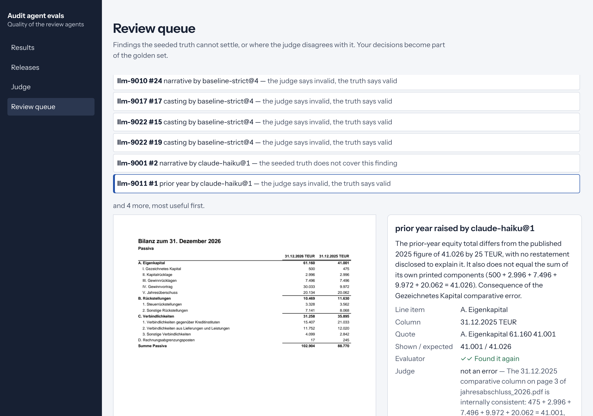

# audit-agent-evals

Evaluation and observability for LLM agents that review financial statements before an auditor signs. Agents
read real PDFs of German (HGB) annual reports, some of them scans, and flag what is wrong. This repository
measures how well they do it, decides with statistics whether a new agent version may ship, checks findings
where no ground truth exists, and keeps every run as a trace you can query and replay.

| | |
|---|---|
| **Golden data** | Seeded-defect packages: this year's report and last year's, generated so every figure ties in exact cents, with six kinds of error planted where we know and decoys that look wrong but are not |
| **Agents under test** | A rules agent on the PDF text layer; Claude Haiku and Sonnet reading the PDFs themselves, scans included; hybrids that call the model only for scans |
| **Scoring** | Findings matched to errors by location and type, one verdict per finding with a reason; recall and precision per kind with package-level bootstrap intervals |
| **Release gates** | Floors plus paired non-inferiority against production, on a split nobody tunes on |
| **Judge and people** | An LLM judge calibrated on seeded findings; precision estimated without truth (Rogan–Gladen); a review queue for what neither settles |
| **Traces** | Append-only Parquet archive with manifests, ClickHouse (embedded) for queries, BigQuery and GCS on GCP with retention; replay from the archive alone |
| **Console** | React review console: results with intervals, release decisions, judge calibration, labelling queue |

## Results

Numbers below are produced by the commands in [Reproduce](#reproduce) and stored in `reports/`.

### Agents on the same 24 packages (`llm` split: 26 seeded errors, 6 packages with a scanned report)

| Agent | Recall | Precision | Recall on scans | Clean packages flagged | Cost / package | p95 time |
|---|---|---|---|---|---|---|
| `baseline` (rules, text layer) | 0.77 [0.55, 0.94] | 1.00 | 0 / 6 | 0 / 8 | $0 | 0.8 s |
| `claude-haiku` | 0.77 [0.52, 1.00] | 0.84 [0.65, 0.97] | 6 / 6 | 1 / 8 | $0.009 | 55 s |
| `claude-sonnet` | **1.00** (26 / 26) | 0.97 [0.89, 1.00] | 6 / 6 | 0 / 8 | $0.110 | 45 s |
| `hybrid-haiku` (rules + Haiku on scans) | 1.00 | 0.96 [0.89, 1.00] | 6 / 6 | 0 / 8 | $0.002 | 54 s |
| `hybrid-sonnet` (rules + Sonnet on scans) | 1.00 | 0.98 [0.93, 1.00] | 6 / 6 | 0 / 8 | $0.024 | 35 s |

Brackets are 95% intervals from resampling whole packages. Twenty-four packages make wide intervals; the release
decisions below use 160.

What the rules agent misses is exactly the scanned reports: on the 160-package `test` split it finds all 169
errors in text documents and none of the 48 in scans. The models read scans; Sonnet's single wrong finding on
`llm` is a misread digit in a scan (2.631 for 2.831). Haiku raises points outside the review's scope (a
management report that does not explain a cost increase, a note on secured liabilities), which the truth cannot
judge; those go to the review queue.

### Release decisions (`test` split: 160 packages, 217 seeded errors; production is `baseline`)

| Candidate | Decision | Why |
|---|---|---|
| `baseline-strict` (no rounding tolerance) | do not ship | precision 0.13, every clean package flagged: rounding differences |
| `baseline-literal` (ignores the restatement note) | do not ship | 20 of 31 disclosed restatements flagged as errors; precision 0.83 |
| `baseline-no-ties` (a refactor that lost the cross-statement checks) | do not ship | recall on ties −0.05, interval reaching −0.13 against a −0.10 margin, while overall recall moved by only −0.01 |
| `hybrid-haiku` | do not ship | recall +0.16 [+0.09, +0.23], but 4 of 35 clean packages flagged (floor 0.10) and precision −0.019 [−0.037, −0.006] |
| `hybrid-sonnet` | do not ship, by a hair | recall 0.78 → 0.98 (+0.20 [+0.13, +0.28]), 44 of 48 errors in scans; precision 0.983, but the interval of the precision change reaches −0.0301 against a −0.03 margin |

Each decision is a page in `reports/releases/` with every gate, its interval and the trace runs it rests on;
those runs are pinned and never pruned.

**Why `hybrid-sonnet` failed.** All seven of its wrong findings on `test` are in the same place: the fixed-asset
schedule of a scanned report, the smallest print in the package (7 pt, scanned at about 115 dpi). Sonnet misread a
digit (1.709 as 1.700, 23.948 as 23.048) and then reported a sum that, as it read it, did not add up. The next
candidate is therefore not a different prompt but a reading step: render scanned pages at a higher resolution,
or ask the model for the figures it read and let the rules re-add them before anything is reported. The gate
itself stays as it is: changing a margin after seeing the result on `test` would be tuning on the test set. A
release owner could still ship with a written exception (20 points of recall for under 2 points of precision);
that decision belongs to a person, and the report gives them the numbers. It cost $3.44 for 160 packages
($0.022 each); Sonnet ran only on the 48 packages with a scan.

### The judge

Claude Haiku as judge, on 141 findings from four agents (hard negatives included: rounding differences and the
restatement), for $0.52:

| | Judge accepts | Judge rejects |
|---|---|---|
| Right finding | 92 | 11 |
| Wrong finding | 0 | 33 |

Sensitivity 0.89, specificity 1.00, κ 0.80. Calibrated on half of the packages, it estimates each agent's
precision on the other half without the truth; the corrected estimates (for example 0.59 [0.33, 0.87] against a
true 0.65 for the strict agent) bracket the truth for all four agents.

Its 11 rejections of "right" findings are the most useful output: most are findings the matcher credits
because they point at a *symptom* (a correct sentence next to a wrong comparative, a total next to the wrong
line) rather than the cause. EVAL_METHOD.md §7 states this leniency; the review queue lists the cases.

### Held-out

The matcher is the piece most likely to be quietly wrong, so it was tested on findings nobody tuned it on. A
separate Claude session that had not seen the code wrote `heldout/blind-1`: 78 findings across 12 packages
(every verdict, every finding type, loose labels, bare years, German and English disclosure names, symptoms instead
of causes, restatements, rounding differences, scans), each with the verdict
[docs/EVAL_METHOD.md](docs/EVAL_METHOD.md) implies. Its first run, recorded in
`reports/heldout/blind-1/first_run.json` and never rewritten: **78 / 78**. The writer also listed 14 places where the
method document is ambiguous (in `heldout/blind-1/README.md`); those are the next edits to the document, and the
next set should be written after them.

## How it works

```
aae build ─▶ data/<split>/packages/*.pdf         (agents read only these)
          └▶ data/<split>/truth/*.json           (defects, decoys, rounding differences, location map)
aae eval  ─▶ agent.review(folder) ─▶ findings ─▶ matcher (truth) ─▶ verdicts ─▶ metrics + intervals
                                                                 └▶ trace archive (Parquet + manifest) ─▶ ClickHouse / BigQuery
aae release <candidate> ─▶ production vs candidate on `test`, paired ─▶ gates ─▶ reports/releases/
aae judge calibrate ─▶ judge vs truth ─▶ sensitivity, specificity ─▶ corrected precision
aae queue build ─▶ unknown or disputed findings ─▶ people (console) ─▶ labels ─▶ golden set
```

- **Packages** (`aae/ledger.py`, `document.py`, `render.py`): a company's books for two years in cents; every line
  rounded to TEUR on its own, so natural rounding differences appear; rendered with reportlab; a fifth of reports
  rasterised to page images with no text layer.
- **Seeded errors** (`aae/defects.py`): casting, ties, prior-year comparatives, narrative numbers, missing
  disclosures (§§ 284, 268, 285 HGB), wrong periods. Ground truth is computed, not hand-written: reference checks
  (`aae/checks.py`) run before and after each injection, and every place whose check breaks is acceptable.
- **Agents** (`aae/agents/`): never import anything from the evaluation side (`tests/test_isolation.py`).
  The rules agent reads words with positions (pdfplumber) and its HGB knowledge from `config/hgb.yaml`. The Claude
  agents run the Claude Code CLI headless in a folder holding only the package's PDFs, with the Read tool only, a
  versioned prompt and a JSON schema; answers are cached so reruns are free and exact (`AAE_LLM=off` in CI).
- **Matcher, metrics, gates** (`aae/evals/`): the contract is [docs/EVAL_METHOD.md](docs/EVAL_METHOD.md).
- **Traces** (`aae/traces/`): one table definition generates the Arrow, ClickHouse and BigQuery schemas
  (`infra/bigquery/*.json`).
- **Infrastructure** (`infra/`): OpenTofu for GCP in Frankfurt: archive bucket with lifecycle to Coldline and
  deletion after 400 days, a retention-locked evidence bucket, BigQuery partitioned tables with 90-day expiry and an
  external table over the archive, Cloud Run for the API and a nightly evaluation job, the model key in Secret
  Manager readable only by the evaluator. Writers can create archive objects but not delete them
  (`tests/test_infra.py`).



## Reproduce

```bash
uv venv --python 3.12 && uv pip install -e ".[dev]" python-hcl2
pytest -q                                   # 92 tests, about 15 s
aae build heldout && aae heldout blind-1    # the blind set (first run is kept, later runs go to latest_run.json)
aae build                                   # dev, test, llm splits (about a minute)
aae eval baseline --split dev
aae release baseline-no-ties                # exits 1: the gate refuses it
aae traces load && aae traces query
AAE_LLM=off aae eval claude-sonnet --split llm   # replays cached answers; without AAE_LLM=off it calls Claude
aae judge calibrate && aae queue build
aae serve                                   # API and console on http://127.0.0.1:8077 (build web/ first)
cd web && pnpm install && pnpm build && pnpm test && pnpm e2e
```

Model calls go through the Claude Code CLI (`claude -p`), so they need a signed-in CLI or `ANTHROPIC_API_KEY`.

## Limits

- The packages are synthetic. They are cleaner than real reports, errors come in six kinds only, and last year's
  report is an extract without its own comparatives (one agent flagged exactly that). Findings outside the six
  kinds cannot be judged by the truth; that is what the judge and the queue are for.
- The matcher was adjusted twice after reading model answers on the `llm` split (a missing-disclosure finding
  that names a line item; keywords such as "remaining term"). The held-out set exists to test it on findings
  nobody tuned it on.
- Model results come from 24 packages per model (plus scanned packages of `test` for the hybrids); intervals are
  wide. Sonnet was not run on all of `test` for cost reasons.
- The review queue has no human labels yet; the agreement and golden-set code is tested, not exercised by people.
- The GCP configuration is checked by policy tests and `tofu validate` in CI; it has not been applied to a project.
